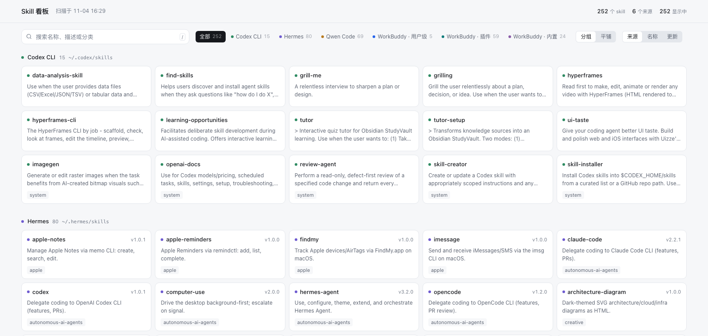
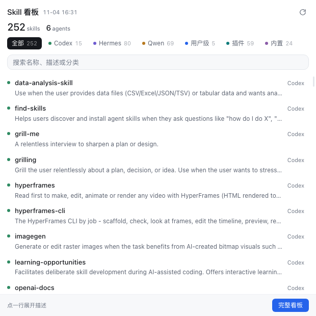

# Skill Board

本机装了 6 个 agent，skill 散在十几个目录里：用户级的、插件缓存的、应用内置的，还有软链共享的。想知道自己到底有哪些，只能一个个 `ls`。

这个脚本把这些 `SKILL.md` 全收集起来，生成一个能搜、能按来源筛的看板。顺手还有个 macOS 菜单栏壳子，点一下就可以看到下面的效果。



## 跑起来

```bash
git clone https://github.com/wangweifeng0808/skill-board.git
cd skill-board
python3 scan_skills.py
open dist/board.html
```

第一次跑会从 `config.example.json` 拷一份 `config.json` 出来，里面预置了几个常见 agent 的路径，扫到多少算多少，扫不到的标成 `missing`，不报错。

改 `config.json` 指向你自己的目录就行。只用 Python 3 标准库，不装东西，不联网。

## 配置

```json
{
  "title": "Skill Board",
  "sources": [
    {
      "key": "codex",
      "label": "Codex CLI",
      "short": "Codex",
      "path": "~/.codex/skills",
      "depth": 2,
      "color": "#2E8B62"
    }
  ],
  "aliases": [
    { "label": "Kimi CLI", "link": "~/.kimi/skills", "target": "~/.codex/skills" }
  ],
  "outputs": {
    "json": "dist/skills.json",
    "board": "dist/board.html",
    "popover": "dist/popover.html"
  }
}
```

`key` 和 `path` 必填，其余都有默认值。

| 字段 | 说明 |
|---|---|
| `depth` | 往下走几层。插件缓存那种 `repo/plugin/version/skills/name` 要 7 |
| `slug_from` | `dir` 用目录名，`after_skills` 取 `skills/` 下一级 |
| `dedup` | `slug` 按名字去重，`parent+slug` 只在同一个插件内去重 |
| `category` | `first` 拿路径第一段当分类，`none` 不要分类 |
| `aliases` | 只做标注的软链，不重复计数 |
| `outputs.board` | 可以直接写桌面路径 |

## 菜单栏（macOS）

```bash
bash macos/build.sh
```

编译完装到 `~/Applications/SkillBar.app` 就起来了。左键弹面板，右键是菜单：重扫、打开完整看板、换目录、登录启动、退出。



每次点开都会在后台重扫一遍，有变化才刷新视图，不用管它。第一次启动要是找不到 `scan_skills.py`，会弹窗让你选目录。

用的是 Cocoa + WebKit，没有第三方依赖，编译需要 Xcode Command Line Tools。不想编译就双击 `scripts/refresh.command`，效果一样。

## 定时刷新

```bash
crontab -e
0 9 * * * cd ~/skill-board && /usr/bin/python3 scan_skills.py --quiet
```

## 几点说明

只认 `SKILL.md` 这个文件名，写成 `skill.md` 就扫不到，要改 `walk_skills`。

frontmatter 是手写的极简解析，只认扁平的 `key: value`，嵌套结构和多行数组会被丢掉。取的键按优先级是 `name`、`description_zh` / `description` / `description_en`、`version`。

插件目录按 `repo/plugin/version/skills/name` 这个结构处理，同一个插件装了多个版本只留最新的那条。别的 agent 要是目录布局不一样，得调 `slug_from` 和 `dedup`。

面板尺寸固定 620×600，内容多了在里面滚。菜单栏图标排第几位由系统决定，程序没法指定。

## License

MIT
